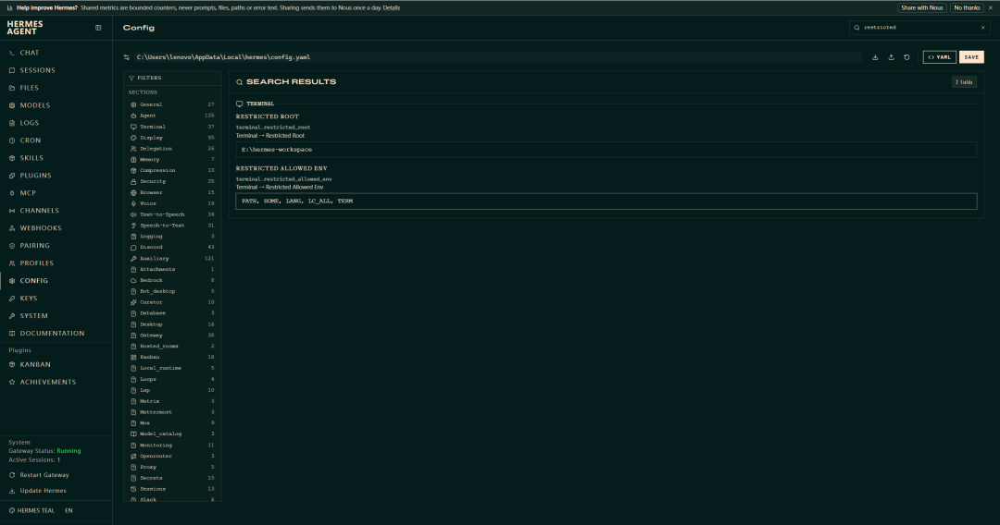

# Hermes Agent `restricted` 执行后端测试报告

- 项目路径：`E:\笔试\hermes-agent`
- 测试日期：2026-11-21
- 测试对象：新增的 `restricted` 执行后端
- 测试文件：`E:\笔试\hermes-agent\tests\tools\test_restricted_environment.py`
- 结论：**五项要求全部满足；13 项自动化测试全部通过。**

---

## 一、测试环境

### 1. 环境版本

| 项目 | 版本 / 路径 |
|---|---|
| Python | 3.14.9（Hermes PM 提供） |
| pytest | 9.1.1 |
| 仓库提交 | `f998a982` |
| Dashboard | `http://127.0.0.1:9119/` |
| 受限根目录 | `E:\hermes-workspace` |

### 2. 打开终端

使用 **PowerShell**，不要用 `cmd`。

原因：本源码仓库中的 `hermes` 是 `activate.ps1` 在当前 PowerShell 会话中定义的函数，`cmd` 中默认找不到 `hermes` 命令。

在 CodeBuddy 内置终端中，先移除安全删除包装，避免 `activate.ps1` 清理不存在的环境变量时报错：

```powershell
Remove-Item function:\Remove-Item -Force -ErrorAction SilentlyContinue
```

普通 Windows PowerShell 中执行这行也没有副作用。

### 3. 激活项目环境

```powershell
cd E:\笔试\hermes-agent
. .\activate.ps1
hermes --version
```

预期输出类似：

```text
Hermes Agent vgit.f998a98 (2026.9.24)
Install directory: E:\笔试\hermes-agent
Python: 3.14.9
OpenAI SDK: 2.54.0
```

---

## 二、配置检查与手动验证

### 1. 查看当前后端配置

```powershell
hermes config get terminal.backend
hermes config get terminal.restricted_root
hermes config get terminal.restricted_allowed_env
hermes doctor
```

当前实际读到：

```text
env_type= restricted
restricted_root= E:\hermes-workspace
restricted_allowed_env= ['PATH', 'HOME', 'LANG', 'LC_ALL', 'TERM']
```

`E:\hermes-workspace` 目录已存在。

### 2. 如需重新配置

```powershell
hermes config set terminal.backend restricted
hermes config set terminal.restricted_root E:\hermes-workspace
hermes config set terminal.restricted_allowed_env '["PATH", "HOME", "LANG", "LC_ALL", "TERM"]'
```

注意：环境变量白名单是列表，需要写成 JSON/YAML 字面量。

### 3. 验证 Hermes 实际创建的子进程工作目录

这条命令会按当前 `config.yaml` 创建 `RestrictedEnvironment`，然后执行 `pwd`：

```powershell
python -c "from tools.terminal_tool import _get_env_config; from tools.terminal_tool_backends import _ENV_BUILDERS, _restricted_config_from_config; c=_get_env_config(); e=_ENV_BUILDERS['restricted'](cwd=c['cwd'], timeout=c['timeout'], restricted_config=_restricted_config_from_config(c)); r=e.execute('pwd'); print('configured_root=',e.root); print('child_pwd=',r['output'].splitlines()[0])"
```

实测输出：

```text
configured_root= E:\hermes-workspace
child_pwd= /e/hermes-workspace
```

说明 Hermes 创建的子进程确实在受限根目录内。

### 4. Dashboard 选择入口验证

打开：

```text
http://127.0.0.1:9119/config
```

页面路径：

```text
Config → Terminal → Backend
```

接口验证：

```text
http://127.0.0.1:9119/api/config/schema
```

`terminal.backend.options` 实测包含：

```text
local, restricted, docker, ssh, modal, daytona, vercel_sandbox
```

---

## 三、自动化测试命令

在已激活的 PowerShell 中执行：

```powershell
& $env:__HERMES_TEST_PYTHON -m pytest --confcutdir=E:\笔试\hermes-agent\tests\tools -v tests/tools/test_restricted_environment.py
```

结果：

```text
13 passed in 7.16s
```

完整测试文件：

```text
E:\笔试\hermes-agent\tests\tools\test_restricted_environment.py
```

---

## 四、五项要求与测试项对应关系

| 题目要求 | 对应测试 | 验证内容 | 结果 |
|---|---|---|---|
| 1. 用子进程执行命令 | `test_execute_uses_a_child_process` | 验证底层返回 `subprocess.Popen`，子进程 PID 与父进程不同，能读到 bash 子进程 PID | PASSED |
| 2. 超时强制终止 | `test_command_times_out_and_is_killed` | 执行 `sleep 10`，设置 `timeout=1`，验证返回码 `124`、`hermes_timed_out=True`、实际耗时小于 6 秒 | PASSED |
| 3. 工作目录限定，挡住路径穿越 | `test_resolve_paths_clamps_cwd_outside_root` | 配置的 cwd 在 root 外时回退到 root | PASSED |
| 3. 工作目录限定，挡住路径穿越 | `test_resolve_paths_allows_relative_cwd_inside_root` | root 内的相对 cwd 正常解析 | PASSED |
| 3. 工作目录限定，挡住路径穿越 | `test_execute_pwd_reports_directory_inside_root` | 子进程执行 `pwd`，结果位于 root 内 | PASSED |
| 3. 工作目录限定，挡住路径穿越 | `test_parent_traversal_in_command_is_rejected` | 命令中出现 `../` 时直接拒绝 | PASSED |
| 3. 工作目录限定，挡住路径穿越 | `test_cd_cannot_escape_root` | `cd /outside/path` 时被 bash 守卫拒绝 | PASSED |
| 4. 环境变量清洗 | `test_build_run_env_forwards_only_allowlisted_names` | 白名单变量透传，非白名单变量和 `HOME` 不透传 | PASSED |
| 4. 环境变量清洗 | `test_child_process_does_not_inherit_host_secret` | 端到端执行 `env`，验证宿主 secret 不出现在子进程环境中 | PASSED |
| 5. 注册为可选后端 | `test_backend_is_registered_in_dispatch_tables` | 验证 `_ENV_BUILDERS` 与 `_BACKEND_SPECS` 中包含 `restricted` | PASSED |
| 5. 注册为可选后端 | `test_create_environment_dispatches_to_restricted` | 通过统一工厂 `_create_environment('restricted')` 实际创建受限环境 | PASSED |
| 辅助 | `test_find_bash_returns_executable` | 能找到可用 bash，且跳过 Windows WSL 启动器 | PASSED |
| 辅助 | `test_shell_path_round_trip` | Windows 路径与 Git Bash 路径互转正确 | PASSED |

### 测试截图

下图是 Dashboard 配置页的实际截图，搜索 `restricted` 后可以看到：

- `Restricted Root = E:\hermes-workspace`
- `Restricted Allowed Env = PATH, HOME, LANG, LC_ALL, TERM`

截图文件：`Q2-restricted-Dashboard配置截图.png`



---

## 五、逐项测试明细

### 1. 子进程执行

测试：

```text
test_execute_uses_a_child_process PASSED
```

验证点：

- `_run_bash()` 返回 `subprocess.Popen`
- 子进程 PID 与当前 Python 进程 PID 不同
- 子进程内 `$$` 能输出数字 PID

结论：满足要求 1。

### 2. 超时强制终止

测试：

```text
test_command_times_out_and_is_killed PASSED
```

验证点：

- 执行 `sleep 10`
- 传入 `timeout=1`
- 返回码为 `124`
- `hermes_timed_out=True`
- 实际耗时小于 6 秒，说明没有等待 10 秒自然结束

结论：满足要求 2。

### 3. 工作目录限定

测试：

```text
test_resolve_paths_clamps_cwd_outside_root PASSED
test_resolve_paths_allows_relative_cwd_inside_root PASSED
test_execute_pwd_reports_directory_inside_root PASSED
test_parent_traversal_in_command_is_rejected PASSED
test_cd_cannot_escape_root PASSED
```

验证点：

- root 外的 cwd 自动回退到 root，避免全局 `terminal.cwd=/root` 导致后端不可用
- root 内相对 cwd 正常解析
- `pwd` 输出位于 root 内
- `cat ../outside.txt` 这类命令文本穿越被拒绝
- `cd /external/path` 被 bash 守卫拒绝

结论：满足要求 3。

### 4. 环境变量清洗

测试：

```text
test_build_run_env_forwards_only_allowlisted_names PASSED
test_child_process_does_not_inherit_host_secret PASSED
```

验证点：

- 白名单变量透传
- 非白名单的宿主环境变量不透传
- 未白名单的 `HOME` 不透传
- 子进程实际环境中看不到 `HERMES_RESTRICTED_SECRET`
- `BASH_ENV`、`ENV`、`SHELLOPTS`、`PROMPT_COMMAND` 等 shell 启动钩子即使出现在白名单里也会被丢弃

结论：满足要求 4。

### 5. 注册为可选后端

测试：

```text
test_backend_is_registered_in_dispatch_tables PASSED
test_create_environment_dispatches_to_restricted PASSED
```

验证点：

- `tools/terminal_tool_backends.py` 的 `_ENV_BUILDERS` 中有 `restricted`
- `_BACKEND_SPECS` 中有 `restricted`
- 统一工厂 `_create_environment('restricted')` 实际返回 `RestrictedEnvironment` 实例
- Dashboard `/api/config/schema` 的下拉选项包含 `restricted`
- `hermes setup terminal` 中可进入 Restricted 配置向导
- `hermes doctor` 会检查 restricted root

结论：满足要求 5。

---

## 六、相关实现文件

| 文件 | 作用 |
|---|---|
| `tools/environments/restricted.py` | 受限后端核心实现：子进程、超时终止、cwd 守卫、env 白名单 |
| `tools/terminal_tool_backends.py` | 后端注册表、配置映射、builder、requirements checker |
| `tools/terminal_tool_lifecycle.py` | 根据配置创建环境实例 |
| `tools/terminal_tool.py` | 读取 `TERMINAL_*` / `terminal.*` 配置 |
| `hermes_cli/config_defaults.py` | `restricted_root`、`restricted_allowed_env` 默认值 |
| `hermes_cli/setup_terminal.py` | `hermes setup terminal` 向导 |
| `hermes_cli/doctor_tools.py` | `hermes doctor` 检查 |
| `hermes_cli/web_server_config.py` | Dashboard 后端下拉框选项 |
| `website/docs/user-guide/configuration.md` | 用户文档 |
| `tests/tools/test_restricted_environment.py` | 自动化测试 |

---

## 七、限制说明

`restricted` 是题目要求的轻量级受限后端，不是生产级安全沙箱：

- 会限制子进程启动目录
- 会拦截 `cd` 越出 root
- 会拦截命令文本中的 `..` 路径穿越
- 会清洗环境变量

但不包含：

- namespace
- seccomp
- 文件系统挂载隔离
- 对绝对路径读取的外部文件进行强制阻断

这与题目中“不要求做到生产级安全”的要求一致。

---

## 八、最终结论

| 项目 | 结果 |
|---|---|
| 五项要求 | 5 / 5 通过 |
| 自动化测试 | 13 / 13 通过 |
| Dashboard 可选 | 是 |
| 真实配置子进程 cwd | `E:\hermes-workspace` |
| 项目可启动 | 是，Dashboard 运行于 `http://127.0.0.1:9119/` |

**测试通过。**

---

## 九、代码仓库地址

Q2 的完整代码已提交到远程仓库，压缩包中只包含测试报告、截图和本说明，不打包代码及编译产物。

- 仓库地址：`https://github.com/giant007/hermes-agent.git`
- 分支：`main`
- 提交：以远端 `main` 分支最新提交为准（包含 restricted 实现、13 项测试与本报告）

获取代码：

```bash
git clone https://github.com/giant007/hermes-agent.git
cd hermes-agent
git checkout main
```
